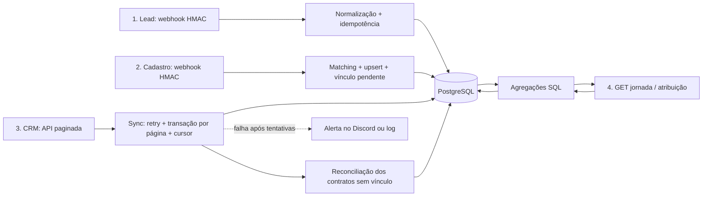

# Partner Journey API

API que liga leads, cadastros e contratos do CRM para atribuir produção aos canais de marketing.

[](https://github.com/LucasR0sa/partner-journey-api/actions/workflows/ci.yml)
[](.nvmrc)
[](tsconfig.json)
[](docker-compose.yml)
[](LICENSE)

## O problema

O marketing gera leads, mas cadastros e contratos chegam por outro sistema, sem um ID compartilhado.
Eventos repetidos, falhas do CRM e dados fora de ordem podem duplicar ou esconder resultados.
Sem ligar essas etapas, não dá para saber quais canais trouxeram parceiros e produção.

## A solução

Webhooks assinados e idempotentes recebem leads e cadastros; matching normalizado liga suas origens.
Uma sync incremental salva todos os contratos e reconcilia vínculos, mesmo quando o cadastro chega depois.
Leituras SQL mostram a jornada do parceiro e a produção por canal, com testes reais e CI em cada PR.

Projeto de portfólio com **dados fictícios**. Stack: Node 22, TypeScript, Express 5, PostgreSQL 16
(SQL puro via `pg`), Zod, Pino, Vitest + Supertest, Docker Compose e GitHub Actions.



## Decisões técnicas

| Decisão                                                                                                | Implementação e motivo                                                                                                                                                                              |
| ------------------------------------------------------------------------------------------------------ | --------------------------------------------------------------------------------------------------------------------------------------------------------------------------------------------------- |
| [ADR 0001 — Webhooks idempotentes](docs/adr/0001-webhooks-idempotentes.md)                             | `UNIQUE(event_id)` + `ON CONFLICT`: a constraint resolve duplicidade inclusive sob concorrência. HMAC é verificado sobre o corpo bruto.                                                             |
| [ADR 0002 — Matching](docs/adr/0002-matching-lead-cadastro.md)                                         | E-mail antes de telefone, lead mais recente e anterior ao cadastro, janela de 90 dias; `match_method` permite auditoria.                                                                            |
| [ADR 0003 — Sync incremental](docs/adr/0003-sincronizacao-incremental.md)                              | Contratos e cursor na mesma transação; retry só para falhas temporárias, vínculo tardio e alerta. Contrato nunca é descartado.                                                                      |
| [Condição de corrida sync × cadastro — PR #5](https://github.com/LucasR0sa/partner-journey-api/pull/5) | Teste com duas conexões reproduz a invisibilidade de linhas não confirmadas em READ COMMITTED. Reconciliação após as páginas garante consistência eventual; releitura não apaga vínculo confirmado. |

Se o CRM transferir o contrato, o novo código substitui a origem anterior, sem herdar o parceiro antigo
([PR #6](https://github.com/LucasR0sa/partner-journey-api/pull/6)).
Arquitetura: [docs/architecture.md](docs/architecture.md). Histórico: [CHANGELOG.md](CHANGELOG.md).

## Demonstração (cerca de 5 minutos)

Pré-requisitos: **Node 22**, npm, Git e Docker Desktop/Compose em execução. A primeira instalação
e o download das imagens podem levar mais de cinco minutos. Use apenas dados fictícios.

Em PowerShell, partindo de uma pasta sem uma cópia do projeto:

```powershell
git clone https://github.com/LucasR0sa/partner-journey-api.git
cd partner-journey-api
Copy-Item .env.example .env
npm ci
docker compose up -d --wait db fake-crm
npm run migrate
npm run dev
```

Em Bash, substitua `Copy-Item .env.example .env` por `cp .env.example .env`.
Se já tem um `.env`, **não o sobrescreva**. O exemplo contém credenciais apenas locais; em outro ambiente,
use um `WEBHOOK_SECRET` próprio. `.env` fica ignorado pelo Git: não é um GitHub Actions Secret.
Deixe `DISCORD_WEBHOOK_URL=` vazio para a demonstração não enviar mensagens externas.

Deixe a API aberta e execute em outro terminal, na mesma pasta:

```powershell
curl.exe -s http://localhost:3000/health
npm run seed
npm run sync
curl.exe -s http://localhost:3000/partners/P0001/journey
curl.exe -s "http://localhost:3000/metrics/attribution?from=2026-04-01&to=2026-10-01"
```

Em Bash, use `curl` no lugar de `curl.exe`. Health responde `{"status":"ok"}`.
O seed envia **300 leads e 150 cadastros** (`P0001` a `P0150`) por webhooks assinados:
50 casam por e-mail, 50 por telefone e 50 ficam sem origem. Pode repetir sem duplicar.
A primeira sync de uma base nova importa **2.000 contratos** do fake-crm, que falha propositalmente
em aproximadamente 15% das chamadas. Se ele ainda estiver iniciando, confira `docker compose logs fake-crm`.
Exemplos de requisições no VS Code REST Client: [requests.http](requests.http).

O PostgreSQL local usa a porta **5433** e um volume persistente. O primeiro início também cria
`journey_test`, banco isolado dos testes. Não use `docker compose down -v` para apenas parar o projeto:
`-v` apaga os dados. Para encerrar, `Ctrl+C` na API e `docker compose stop`.

## Endpoints

| Método | Rota                             | Status | Resposta                            |
| ------ | -------------------------------- | ------ | ----------------------------------- |
| GET    | `/health`                        | ✅     | 200; verifica a conexão com o banco |
| POST   | `/webhooks/leads`                | ✅     | HMAC; 201 criado / 200 duplicado    |
| POST   | `/webhooks/signups`              | ✅     | HMAC; 201 criado / 200 atualizado   |
| GET    | `/partners/:code/journey`        | ✅     | 200; 404 se o parceiro não existe   |
| GET    | `/metrics/attribution?from=&to=` | ✅     | 200; 422 para filtros inválidos     |

**Leituras sem autenticação nesta versão.** Não exponha dados reais sem autenticação e autorização.
Os webhooks exigem `x-signature: sha256=<HMAC-SHA256>` sobre os bytes exatos do JSON; assinatura
inválida retorna 401 e corpo inválido, 422. JSON malformado retorna 400.

<details>
<summary>Resposta de GET /partners/P0001/journey, após seed + sync</summary>

```json
{
  "crmCode": "P0001",
  "name": "Parceiro 1",
  "lead": {
    "source": "google_ads",
    "campaign": "campanha-2",
    "occurredAt": "2026-04-01T12:00:00.000Z"
  },
  "matchMethod": "email",
  "signedUpAt": "2026-04-08T12:00:00.000Z",
  "production": {
    "totalCents": 7301098,
    "contracts": 7,
    "firstPaidAt": "2026-04-12",
    "lastPaidAt": "2026-08-29"
  }
}
```

A jornada mostra toda a produção histórica vinculada, sem filtro de período.
Sem lead, `lead` é `null`; sem contratos, totais são zero e datas são `null`.

</details>

<details>
<summary>Resposta de GET /metrics/attribution?from=2026-04-01&amp;to=2026-10-01, após seed + sync</summary>

```json
{
  "from": "2026-04-01",
  "to": "2026-10-01",
  "rows": [
    {
      "source": "sem_cadastro",
      "newPartners": 0,
      "producingPartners": 0,
      "contracts": 532,
      "totalCents": 534481422
    },
    {
      "source": "sem_origem",
      "newPartners": 50,
      "producingPartners": 50,
      "contracts": 490,
      "totalCents": 533399020
    },
    {
      "source": "organico",
      "newPartners": 25,
      "producingPartners": 25,
      "contracts": 265,
      "totalCents": 296590848
    },
    {
      "source": "google_ads",
      "newPartners": 25,
      "producingPartners": 25,
      "contracts": 241,
      "totalCents": 248444998
    },
    {
      "source": "meta_ads",
      "newPartners": 25,
      "producingPartners": 25,
      "contracts": 241,
      "totalCents": 244141714
    },
    {
      "source": "indicacao",
      "newPartners": 25,
      "producingPartners": 25,
      "contracts": 231,
      "totalCents": 223414402
    }
  ],
  "totals": {
    "newPartners": 150,
    "producingPartners": 150,
    "contracts": 2000,
    "totalCents": 2080472404
  }
}
```

</details>

### Definição das métricas

- `newPartners`: cadastros com `signed_up_at` no período, tenham ou não produção.
- `producingPartners`: parceiros distintos com pagamentos no período, mesmo cadastrados antes dele.
- `contracts` e `totalCents`: contratos e soma em **centavos inteiros**, filtrados por `paid_at`.
- `source`: canal atual do lead; `sem_origem` para cadastro sem lead e `sem_cadastro` para contrato
  sem vínculo. `sem_cadastro` tem zero parceiros nas duas contagens.

**Fuso do negócio:** `from` e `to` são datas locais em **America/Sao_Paulo**, inclusivas.
Para `signed_up_at`, [AT TIME ZONE](https://www.postgresql.org/docs/16/functions-datetime.html#FUNCTIONS-DATETIME-ZONECONVERT)
converte o início do primeiro dia e o início do dia seguinte ao último em instantes, sem depender
do fuso da sessão PostgreSQL. Assim, **31/10 às 22h em São Paulo (01h UTC de 01/11) conta em outubro**.
O motivo é o calendário do negócio, não horário de verão. `paid_at` já é uma data do CRM;
não recebe conversão. Timestamps nas respostas continuam em UTC.

Filtros obrigatórios: datas reais `YYYY-MM-DD` (anos 0001–9999), `from <= to`, no máximo
**366 dias contando as duas pontas**. Canais com cadastro ou produção aparecem por `totalCents`
decrescente, com desempate pelo nome. Sem atividade: `rows: []` e totais zero.

## Sincronização e recuperação

`npm run sync` executa uma vez e fecha o pool; **não há agendador nesta versão**.
Cada página confirma contratos e cursor na mesma transação. Retry: até cinco tentativas,
backoff exponencial com jitter, somente para HTTP 5xx e 429. Erros 4xx permanentes não são repetidos.
O cursor final preserva o início da última página para encontrar novos contratos sem reler tudo.

- `upserted`: contratos inseridos **ou atualizados** nesta execução.
- `unlinked`: contratos gravados sem parceiro naquele momento, antes da reconciliação.
- `relinked`: contratos pendentes vinculados pela reconciliação ao final da sync.
- `linkedContracts`: vínculo tardio feito na transação do cadastro, registrado no log do webhook.

Para recuperar contratos ignorados por versões antigas ou alterações do CRM em páginas anteriores:

```bash
npm run migrate
npm run sync:full
```

O comando zera **somente o cursor** de `production_sync`, sem apagar contratos. UPSERT permite
reprocessar sem duplicar. Se falhar, `npm run sync` retoma da última página confirmada.
Execute sem outra sync em andamento; exclusão mútua entre jobs ainda não foi implementada.
A API HTTP não precisa estar rodando para sincronizar.

### Alerta de falha

Com `DISCORD_WEBHOOK_URL` configurado, a falha após as tentativas envia job, cursor e erro ao Discord.
Sem URL, fica somente no log; falhar ao enviar o alerta nunca esconde a falha original.
Exemplo com Discord desativado, sem campos de processo:

```json
{
  "level": 40,
  "title": "Sync de produção falhou",
  "details": {
    "job": "production_sync",
    "cursor": "1900",
    "erro": "CRM respondeu 503",
    "tentativas": 5
  },
  "msg": "alerta (Discord desativado)"
}
```

Para exercitar localmente em PowerShell, deixe `DISCORD_WEBHOOK_URL=` vazio no `.env` e sem
sobreposição no terminal. Force a falha, aguarde o CRM reiniciar e rode a sync:

```powershell
$env:FAIL_RATE = "1"
docker compose up -d --force-recreate fake-crm
docker compose logs -f fake-crm
# Ao ver "falha 100%", Ctrl+C sai apenas dos logs.
npm run sync
# Restaure depois:
Remove-Item Env:FAIL_RATE
docker compose up -d --force-recreate fake-crm
```

A falha preenche `last_error` sem desfazer páginas confirmadas; uma sync bem-sucedida limpa o erro.

## Testes

**90 testes automatizados, sem testes ignorados ou pendentes.** Unitários verificam normalização,
HMAC, matching e limites de 90 dias, retry, ambiente e alertas. Integração usa **PostgreSQL real**:
webhooks, dez entregas concorrentes do mesmo evento, cursor/rollback por página, migração de base
existente, recuperação completa, vínculo tardio, corrida com duas conexões, transferência de contrato,
jornada e atribuição com fechamento mensal no fuso de São Paulo.

```bash
docker compose up -d --wait db fake-crm
npm test                   # unitários + integração; banco journey_test
npm run test:unit          # sem banco
npm run test:integration   # PostgreSQL real
npm run lint
npm run typecheck
npm run format:check -- README.md ROADMAP.md CHANGELOG.md src/modules/journey
```

Não aponte os testes para o banco de desenvolvimento/produção: eles limpam suas tabelas.
O padrão é `journey_test` na porta 5433; a CI fornece um PostgreSQL isolado.
O workflow verifica formatação, ESLint, TypeScript e testes, depois constrói a imagem Docker.
**CI automatizada e build reproduzível; deploy contínuo não está implementado.**

## Leituras e desempenho

A jornada usa `LEFT JOIN leads` + agregação `LATERAL` da produção em **um SELECT**, preservando
parceiros sem contratos. A atribuição agrega cadastros e pagamentos separadamente e faz `FULL JOIN`
por canal, sem multiplicar contagens. SQL parametrizado em repositories; regras em services.

Medição local registrada no [PR #7](https://github.com/LucasR0sa/partner-journey-api/pull/7), com
300 leads, 150 parceiros, 2.000 contratos e cache aquecido; não é promessa de latência:

| Consulta                      | Antes da migration 003                                        | Depois                                                             |
| ----------------------------- | ------------------------------------------------------------- | ------------------------------------------------------------------ |
| Jornada `P0001`               | Índice `production_partner_paid_idx`, 7 contratos, 14 buffers | Mesmo plano, sem novo índice                                       |
| Atribuição de `2026-05-01`    | Seq Scan: 2.000 contratos, 62 buffers, ~0,31 ms               | Índice `production_paid_at_idx`: 5 contratos, 19 buffers, ~0,24 ms |
| Atribuição de abril a outubro | Seq Scan: 2.000 contratos, 66 buffers, ~1,59 ms               | Mesmo plano, apropriado para ler toda a base                       |

Somente `production(paid_at)` foi acrescentado. O índice experimental em `partners(signed_up_at)`
não mudou o plano com 150 parceiros e não foi mantido. Para inspecionar as queries atuais:

```bash
npm run explain:reads -- P0001 2026-05-01 2026-05-01
```

## O que eu faria a seguir

1. JWT e autorização nas leituras antes de expor dados reais.
2. Advisory lock para impedir duas sincronizações simultâneas.
3. INSERT em lote, somente após medir o ganho com `EXPLAIN (ANALYZE, BUFFERS)`.
4. OpenAPI para documentar e exercitar os contratos HTTP.

Evolução e perguntas de entrevista: [ROADMAP.md](ROADMAP.md).

## Licença

[MIT](LICENSE).
