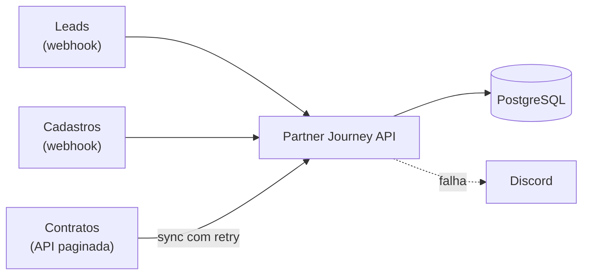

# Partner Journey API

[](https://github.com/LucasR0sa/partner-journey-api/actions/workflows/ci.yml)

API que acompanha cada parceiro **do lead ao resultado**: recebe leads do marketing por webhook,
liga cada cadastro ao lead de origem e sincroniza a produção do CRM, para responder
_"quanto cada canal trouxe de parceiros e de produção?"_.

Versão aberta, com dados fictícios, da arquitetura que construí em produção numa promotora de crédito
(96,8% dos cadastros ligados ao lead de origem).



## Stack

Node.js 22 · TypeScript · Express 5 · PostgreSQL 16 (SQL puro, sem ORM) · Zod · Pino · Vitest + Supertest · Docker · GitHub Actions

## Decisões técnicas

|                                                    | Decisão                                                                | Por quê                                                              |
| -------------------------------------------------- | ---------------------------------------------------------------------- | -------------------------------------------------------------------- |
| [0001](docs/adr/0001-webhooks-idempotentes.md)     | Idempotência por `UNIQUE(event_id)` + `ON CONFLICT`                    | Webhook chega repetido; a constraint resolve até com várias réplicas |
| [0002](docs/adr/0002-matching-lead-cadastro.md)    | Matching normalizado, e-mail > telefone, last touch, janela de 90 dias | Liga o cadastro ao lead sem id em comum, de forma auditável          |
| [0003](docs/adr/0003-sincronizacao-incremental.md) | Cursor + transação por página + retry com backoff + alerta no Discord  | API instável não deixa dado pela metade nem falha em silêncio        |

Arquitetura completa: [docs/architecture.md](docs/architecture.md)

## Rodando

```bash
cp .env.example .env
docker compose up -d db fake-crm
npm ci
npm run migrate
npm run dev        # http://localhost:3000/health
npm run seed       # 300 leads + 150 cadastros fictícios via webhooks assinados
```

Ou tudo em container: `docker compose up --build`.

O Postgres do Compose fica em `localhost:5433` para não conflitar com uma instalação local na porta padrão.
Na primeira inicialização, ele também cria o banco isolado `journey_test` usado pelos testes de integração.

O seed cria os parceiros `P0001` a `P0150`, compatíveis com os códigos do fake-crm:
50 ligados por e-mail, 50 somente por telefone e 50 sem lead de origem.
Rodar novamente não duplica os leads nem os parceiros; os cadastros existentes são atualizados.

## Testes

```bash
npm test               # unitários + integração (precisa do Postgres do compose)
npm run test:unit      # só unitários, sem banco
```

Os testes de integração usam Postgres de verdade, inclusive um teste de **concorrência**
(o mesmo evento 10× em paralelo → 1 linha).

## Formatação

O Prettier padroniza a formatação e complementa as verificações do ESLint.
Os scripts aceitam arquivos ou diretórios. A CI verifica os arquivos adotados pelo formatador,
incluindo o módulo de cadastros, seus testes, a composição da API e o seed:

```bash
npm run format -- src/modules/signups/signup.service.ts tests/unit/match.test.ts
npm run format:check -- src/modules/signups/signup.service.ts tests/unit/match.test.ts
```

## Endpoints

| Método | Rota                             | Status |
| ------ | -------------------------------- | ------ |
| GET    | `/health`                        | ✅     |
| POST   | `/webhooks/leads`                | ✅     |
| POST   | `/webhooks/signups`              | ✅     |
| GET    | `/partners/:code/journey`        | 🚧     |
| GET    | `/metrics/attribution?from=&to=` | 🚧     |

### Exemplo: enviando um lead

```bash
BODY='{"event_id":"evt-1","occurred_at":"2026-10-01T12:00:00Z","source":"meta_ads","contact":{"email":"ana@exemplo.com"}}'
SIG=$(printf '%s' "$BODY" | openssl dgst -sha256 -hmac "$WEBHOOK_SECRET" -hex | cut -d' ' -f2)
curl -X POST localhost:3000/webhooks/leads -H "content-type: application/json" -H "x-signature: sha256=$SIG" -d "$BODY"
# 201 {"id":1,"status":"created"}  → de novo: 200 {"status":"duplicate"}
```

## Estrutura

```
src/
  app.ts                 # monta o Express com as dependências injetadas
  server.ts              # sobe, aplica migrations, desliga com graça
  config/env.ts          # variáveis validadas com Zod (falha cedo)
  db/                    # pool, runner de migrations, .sql
  modules/<módulo>/      # routes → service → repository
  shared/                # normalize, hmac, retry, alertas, erros
tests/unit | tests/integration
tools/fake-crm.ts        # CRM falso que falha 15% das vezes, de propósito
docs/adr/                # decisões técnicas
```

## Licença

MIT
