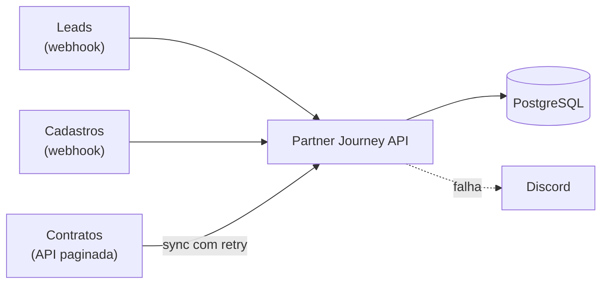

# Partner Journey API

[](https://github.com/LucasR0sa/partner-journey-api/actions/workflows/ci.yml)

API que acompanha cada parceiro **do lead ao resultado**: recebe leads do marketing por webhook,
liga cada cadastro ao lead de origem e sincroniza a produção do CRM, para responder
_"quanto cada canal trouxe de parceiros e de produção?"_.

Versão aberta, com dados fictícios, da arquitetura que construí em produção numa promotora de crédito
(96,8% dos cadastros ligados ao lead de origem).



## Stack

Node.js 22 · TypeScript · Express 5 · PostgreSQL 16 (SQL puro, sem ORM) · Zod · Pino · Vitest + Supertest · Docker · GitHub Actions

## Decisões técnicas

|                                                    | Decisão                                                                | Por quê                                                              |
| -------------------------------------------------- | ---------------------------------------------------------------------- | -------------------------------------------------------------------- |
| [0001](docs/adr/0001-webhooks-idempotentes.md)     | Idempotência por `UNIQUE(event_id)` + `ON CONFLICT`                    | Webhook chega repetido; a constraint resolve até com várias réplicas |
| [0002](docs/adr/0002-matching-lead-cadastro.md)    | Matching normalizado, e-mail > telefone, last touch, janela de 90 dias | Liga o cadastro ao lead sem id em comum, de forma auditável          |
| [0003](docs/adr/0003-sincronizacao-incremental.md) | Cursor + transação por página + retry com backoff + alerta no Discord  | API instável não deixa dado pela metade nem falha em silêncio        |

Arquitetura completa: [docs/architecture.md](docs/architecture.md)

## Rodando

```bash
cp .env.example .env
docker compose up -d db fake-crm
npm ci
npm run migrate
npm run dev        # http://localhost:3000/health
npm run seed       # 300 leads + 150 cadastros fictícios via webhooks assinados
```

Ou tudo em container: `docker compose up --build`.

O Postgres do Compose fica em `localhost:5433` para não conflitar com uma instalação local na porta padrão.
Na primeira inicialização, ele também cria o banco isolado `journey_test` usado pelos testes de integração.

O seed cria os parceiros `P0001` a `P0150`, compatíveis com os códigos do fake-crm:
50 ligados por e-mail, 50 somente por telefone e 50 sem lead de origem.
Rodar novamente não duplica os leads nem os parceiros; os cadastros existentes são atualizados.

## Sincronização

Com o `.env` configurado, suba as dependências e aplique as migrations:

```bash
docker compose up -d db fake-crm
npm run migrate
```

Mantenha `npm run dev` aberto em outro terminal. Depois de criar os parceiros com o seed,
execute a sincronização uma vez:

```bash
npm run seed
npm run sync
```

O comando fecha o pool ao terminar; não há agendamento contínuo neste bloco.
Cada página confirma contratos e cursor na mesma transação. O retry tem até 5 tentativas
por página, com backoff exponencial e jitter, somente para HTTP 5xx e 429.

Exemplo observado com o seed e o fake-crm padrão (campos de processo omitidos):

```json
{
  "level": 30,
  "job": "production_sync",
  "pages": 20,
  "upserted": 2000,
  "unlinked": 532,
  "relinked": 0,
  "msg": "sincronização de produção concluída"
}
```

`upserted` conta inserções **e atualizações** de todos os contratos. `unlinked` conta, nessa execução,
os contratos gravados sem vínculo: `partner_code` é preservado e `partner_id` fica `null`.
Quando o webhook cadastra o parceiro, o UPSERT do cadastro e o vínculo da produção pendente
acontecem na mesma transação. O log do cadastro inclui `linkedContracts`, a quantidade vinculada;
o reenvio não conta novamente contratos já vinculados. Nenhum contrato é descartado.
Antes de marcar sucesso, a sync reconcilia pendências de qualquer página com parceiros já
confirmados e registra quantos contratos vinculou em `relinked`. `unlinked` reflete o estado
gravado em cada UPSERT, antes dessa reconciliação; não é o total final de pendências no banco.
O `COALESCE` preserva um vínculo confirmado durante uma releitura concorrente apenas se
`partner_code` não mudou. Se o CRM transferir o contrato, o vínculo antigo é substituído;
quando o novo parceiro ainda não existe, o contrato aguarda seu cadastro com `partner_id` nulo.

Na segunda execução, o total continuou em **2.000 linhas**, sendo 532 ainda sem cadastro:

```json
{
  "level": 30,
  "job": "production_sync",
  "pages": 1,
  "upserted": 100,
  "unlinked": 21,
  "relinked": 0,
  "msg": "sincronização de produção concluída"
}
```

O cursor final ficou em `1900`, início da última página: relê-la permite encontrar contratos novos
sem baixar todas as páginas novamente. Se o CRM só tiver uma página (ou estiver vazio), o cursor
inicial `null` também representa a última página. O vínculo tardio não consulta o CRM nem altera
o cursor: ele usa os contratos que já estão no PostgreSQL, inclusive os de páginas antigas.

### Recuperando contratos descartados na versão anterior

Use `sync:full` após atualizar uma base que ignorava contratos sem parceiro ou quando precisar
recapturar alterações do CRM em páginas anteriores. Com o banco e o fake-crm no ar:

```bash
npm run migrate
npm run sync:full
```

A migration **002** preenche `partner_code` nas linhas existentes antes de aplicar `NOT NULL`
e permite `partner_id` nulo. A migration 001, já aplicada, não é modificada.
O comando reinicia somente o cursor de `production_sync` e reutiliza a sincronização normal;
não apaga contratos. O `ON CONFLICT` permite repetir a recuperação sem duplicar produção.
Não precisa da API HTTP rodando: o comando acessa diretamente o CRM e o banco.

Na validação de uma base antiga, a migration preservou as 1.468 linhas existentes e a recuperação
trouxe os 532 contratos descartados, totalizando 2.000. Os 532 ficam disponíveis para vínculo
quando seus parceiros se cadastrarem. Depois, volte a usar `npm run sync` no fluxo incremental.
Se a recuperação falhar, as páginas confirmadas permanecem gravadas e `npm run sync` retoma
do cursor salvo. Execute sem outra sincronização em andamento; lock entre jobs fica fora deste PR.
Decisão: [ADR 0003](docs/adr/0003-sincronizacao-incremental.md).

### Forçando uma falha sem enviar mensagem ao Discord

No `.env`, deixe `DISCORD_WEBHOOK_URL=` vazio e confira que o terminal não tem essa variável
preenchida. Assim, o alerta fica somente no log. No PowerShell, force 100% de falhas do fake-crm:

```powershell
$env:FAIL_RATE = "1"
docker compose up -d --force-recreate fake-crm
docker compose logs -f fake-crm
```

Aguarde a mensagem `fake-crm em http://localhost:4000 (falha 100%)` e pressione `Ctrl+C`
para sair **dos logs**, sem parar o container. Então execute:

```powershell
npm run sync
$LASTEXITCODE # 1, depois das 5 tentativas
```

Exemplo de alerta (campos de processo omitidos):

```json
{
  "level": 40,
  "title": "Sync de produção falhou",
  "details": {
    "job": "production_sync",
    "cursor": "1900",
    "erro": "CRM respondeu 503",
    "tentativas": 5
  },
  "msg": "alerta (Discord desativado)"
}
```

A falha preenche `sync_state.last_error`, preserva o cursor e não desfaz páginas já confirmadas.
Restaure a taxa padrão de 15% e acompanhe os logs até o CRM ficar pronto novamente:

```powershell
Remove-Item Env:FAIL_RATE
docker compose up -d --force-recreate fake-crm
docker compose logs -f fake-crm
```

Saia dos logs com `Ctrl+C` e rode `npm run sync`. Ao concluir, `last_error` volta a `null`.
Se tiver alterado uma URL de Discord existente para a demonstração, restaure-a depois.

## Demonstração (cerca de 5 minutos)

Pré-requisitos: Node 22, Docker Compose e dependências baixadas. A primeira instalação e o download
das imagens podem demorar mais. Na raiz do repositório, em um terminal:

```bash
cp .env.example .env
npm ci
docker compose up -d --wait db fake-crm
npm run migrate
npm run dev
```

Deixe a API aberta. Em outro terminal, na mesma pasta:

```bash
npm run seed
npm run sync
```

O seed é idempotente. Em base nova, a sync percorre todas as páginas; se você estiver recuperando
uma base antiga incompleta, use `npm run sync:full`. Aguarde o fake-crm iniciar na porta 4000.
As leituras abaixo **não exigem HMAC nem JWT**; JWT fica nos extras do roadmap. Esta demonstração
usa dados fictícios: não exponha informações reais sem implementar autenticação e autorização.
No PowerShell, use `curl.exe` no lugar do alias `curl`.

```bash
curl -s http://localhost:3000/partners/P0001/journey
```

Resposta real com o seed e 2.000 contratos (campos de contato não são expostos):

```json
{
  "crmCode": "P0001",
  "name": "Parceiro 1",
  "lead": {
    "source": "google_ads",
    "campaign": "campanha-2",
    "occurredAt": "2026-04-01T12:00:00.000Z"
  },
  "matchMethod": "email",
  "signedUpAt": "2026-04-08T12:00:00.000Z",
  "production": {
    "totalCents": 7301098,
    "contracts": 7,
    "firstPaidAt": "2026-04-12",
    "lastPaidAt": "2026-08-29"
  }
}
```

```bash
curl -s "http://localhost:3000/metrics/attribution?from=2026-04-01&to=2026-10-01"
```

Resposta real resumida: `rows` mostra as duas primeiras das seis linhas; `totals` soma todas elas.

```json
{
  "from": "2026-04-01",
  "to": "2026-10-01",
  "rows": [
    {
      "source": "sem_cadastro",
      "newPartners": 0,
      "producingPartners": 0,
      "contracts": 532,
      "totalCents": 534481422
    },
    {
      "source": "sem_origem",
      "newPartners": 50,
      "producingPartners": 50,
      "contracts": 490,
      "totalCents": 533399020
    }
  ],
  "totals": {
    "newPartners": 150,
    "producingPartners": 150,
    "contracts": 2000,
    "totalCents": 2080472404
  }
}
```

### Definição das métricas

- `newPartners`: cadastros com `signed_up_at` no período, tenham ou não produção.
- `producingPartners`: parceiros distintos com contratos pagos no período, mesmo cadastrados antes dele.
- `contracts` e `totalCents`: quantidade de contratos e soma em centavos por `paid_at`, inclusive produção sem cadastro.
- `source`: fonte atual do lead vinculado; `sem_origem` identifica cadastro sem lead e `sem_cadastro`, produção com `partner_id` nulo. Este último tem zero parceiros nas duas contagens.

As datas são obrigatórias, reais e no formato `YYYY-MM-DD`, de `0001` a `9999`.
Os limites são inclusivos, em UTC, com no máximo **366 dias contando as duas pontas**.
Para cadastros, o SQL usa início do primeiro dia até antes do dia seguinte ao último;
isso inclui horários como `23:59:59.999` sem depender do fuso da sessão PostgreSQL.
A resposta contém canais com cadastro ou produção no período, ordenados por `totalCents`
decrescente e, nos empates, pelo nome do canal. Período sem atividade retorna `rows: []` e totais zero.
Código inexistente responde 404 `partner_not_found`; filtros inválidos respondem 422.
A jornada mostra toda a produção histórica vinculada ao parceiro, sem filtro de período.

## Leituras e desempenho

A jornada usa um único SELECT com `LEFT JOIN leads` e agregação `LATERAL` da produção por parceiro:
mantém uma linha mesmo sem contratos, com soma/contagem zero e datas nulas. O vínculo com `leads`
pela chave primária não multiplica linhas por si só; a produção é uma relação 1:N. Agregar antes
evita contar o cadastro uma vez por contrato e facilita futuras relações 1:N sem inflar os totais.
A atribuição agrega cadastros e pagamentos separadamente e combina os canais com `FULL JOIN`,
pois cada métrica usa uma data diferente e pode existir sem a outra.

Medição local após seed + sync e `ANALYZE`: 300 leads, 150 parceiros, 2.000 contratos,
com `EXPLAIN (ANALYZE, BUFFERS)` e cache aquecido. Os tempos são exemplos locais, não SLA.

| Consulta                      | Antes da migration 003                                                          | Depois                                                                           |
| ----------------------------- | ------------------------------------------------------------------------------- | -------------------------------------------------------------------------------- |
| Jornada `P0001`               | Bitmap Index Scan no `production_partner_paid_idx`, 7 contratos, 14 buffers     | Mesmo plano e 14 buffers; nenhum índice novo necessário para a jornada           |
| Atribuição de `2026-05-01`    | Seq Scan em `production`: 2.000 linhas, 1.995 descartadas; 62 buffers; ~0,31 ms | Bitmap Index Scan no `production_paid_at_idx`: 5 contratos; 19 buffers; ~0,24 ms |
| Atribuição de abril a outubro | Seq Scan dos 2.000 contratos; 66 buffers; ~1,59 ms                              | Continua Seq Scan, apropriado para ler a base toda; 66 buffers; ~1,59 ms         |

A migration **003** adiciona somente `production(paid_at)`. O índice experimental em
`partners(signed_up_at)` não mudou o plano com 150 parceiros, então não foi mantido.
As migrations 001 e 002 permanecem intactas. Os índices experimentais foram comparados em
transação e desfeitos; somente o índice escolhido foi aplicado pela migration.
Para reproduzir com as mesmas queries do repository:

```bash
npm run explain:reads -- P0001 2026-05-01 2026-05-01
npm run explain:reads -- P0001 2026-04-01 2026-10-01
```

## Testes

```bash
npm test               # unitários + integração (precisa do Postgres do compose)
npm run test:unit      # só unitários, sem banco
```

Os testes de integração usam Postgres de verdade, inclusive um teste de **concorrência**
(o mesmo evento 10× em paralelo → 1 linha).

## Formatação

O Prettier padroniza a formatação e complementa as verificações do ESLint.
Os scripts aceitam arquivos ou diretórios. A CI verifica os arquivos adotados pelo formatador,
incluindo cadastros, sincronização, seus testes, a composição da API e o seed:

```bash
npm run format -- src/modules/signups/signup.service.ts tests/unit/match.test.ts
npm run format:check -- src/modules/signups/signup.service.ts tests/unit/match.test.ts
```

## Endpoints

| Método | Rota                             | Status |
| ------ | -------------------------------- | ------ |
| GET    | `/health`                        | ✅     |
| POST   | `/webhooks/leads`                | ✅     |
| POST   | `/webhooks/signups`              | ✅     |
| GET    | `/partners/:code/journey`        | ✅     |
| GET    | `/metrics/attribution?from=&to=` | ✅     |

### Exemplo: enviando um lead

```bash
BODY='{"event_id":"evt-1","occurred_at":"2026-10-01T12:00:00Z","source":"meta_ads","contact":{"email":"ana@exemplo.com"}}'
SIG=$(printf '%s' "$BODY" | openssl dgst -sha256 -hmac "$WEBHOOK_SECRET" -hex | cut -d' ' -f2)
curl -X POST localhost:3000/webhooks/leads -H "content-type: application/json" -H "x-signature: sha256=$SIG" -d "$BODY"
# 201 {"id":1,"status":"created"}  → de novo: 200 {"status":"duplicate"}
```

## Estrutura

```
src/
  app.ts                 # monta o Express com as dependências injetadas
  server.ts              # sobe, aplica migrations, desliga com graça
  config/env.ts          # variáveis validadas com Zod (falha cedo)
  db/                    # pool, runner de migrations, .sql
  modules/<módulo>/      # routes → service → repository
  shared/                # normalize, hmac, retry, alertas, erros
tests/unit | tests/integration
tools/fake-crm.ts        # CRM falso que falha 15% das vezes, de propósito
docs/adr/                # decisões técnicas
```

## Licença

MIT
