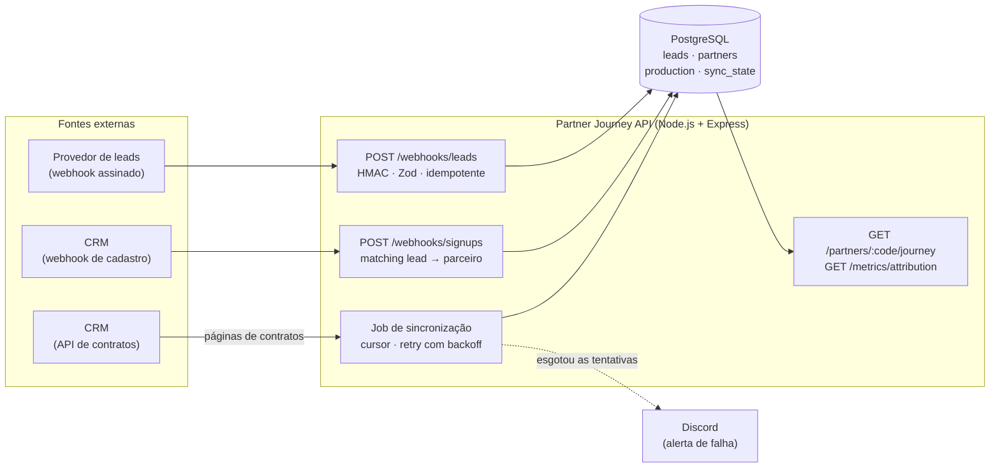

# Arquitetura



## Camadas de cada módulo

```
routes      → HTTP: assinatura, validação (Zod), status code
service     → regra de negócio pura (testável sem banco)
repository  → SQL (pg, sem ORM)
```

`createApp(deps)` recebe o banco por parâmetro: os testes de integração passam um Postgres de teste, e a produção passa o pool real.

## Modelo de dados

| Tabela | Para quê | Garantia principal |
|---|---|---|
| `leads` | leads recebidos do marketing | `UNIQUE(event_id)`: o mesmo evento nunca entra duas vezes |
| `partners` | parceiros cadastrados no CRM | `lead_id` + `match_method` registram *como* o vínculo foi feito |
| `production` | contratos pagos | `UNIQUE(crm_contract_id)`: re-sincronizar faz UPSERT, não duplica |
| `sync_state` | cursor e saúde de cada job | recomeça da última página confirmada |
